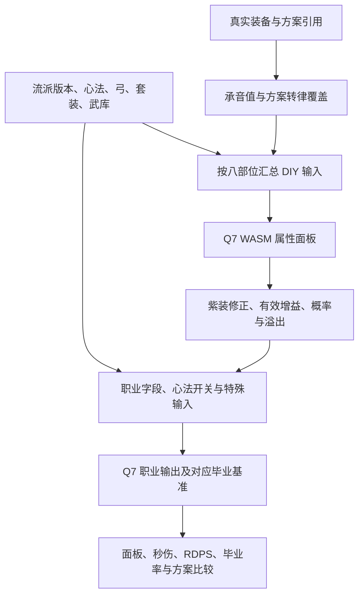

# 调率工具完整机制与设计说明（GDD）

> 更新日期：2026-11-09。本次核对代码基线：`00f6779ceac37b7c28034fff08f14f4efa0da914`；Q7 快照时间：2026年11月8日 22:09:50。既有用户确认规则沿用 2026-11-08 版本，规则编号保留。本次只补文档，没有修改应用、引擎、词条池或用户数据。

本文集中回答“网站允许什么装备、怎么搭配、怎么计算、怎么显示、怎么保存”。它描述本站采用的机制与配置，不将工具限制冒充游戏的全部规则。页面和源码是本次静态核对依据；未逐项回游戏验真，也未逆向证明 WASM 内全部技能公式。

**阅读约定**：原有 `GDD-*` 规则中明确的用户要求是设计目标；标为“当前实现／配置快照”的表格描述代码事实；二者不一致时在“已知差异”保留记录，不通过改文档掩盖差异。可观察验收条件仍放在 [SRS](SRS.md)，代码组织与存储键见 [SDS](SDS.md)。

## 📋 设计导航与术语

| 要查什么 | 章节 |
| --- | --- |
| 每个装备部位有哪些主、副、定音词条；各词条满值 | [装备与词条](#equipment) |
| 每种武库能转出什么；承音、转律、满定音规则 | [承音与转律](#upgrades) |
| 流派用什么武器、套装和心法；版本与环境设置 | [流派与计算环境](#configuration) |
| 从装备、心法到计算器再到面板的完整链路 | [计算链](#calculation) |
| 概率上限、溢出、DPS、RDPS、毕业率和显示 | [面板与输出](#outputs) |
| 六类分析、手动试算和最佳配装 | [分析与搜索](#analysis) |
| 角色、方案、导入导出、云备份和回收站 | [档案与方案](#records) |
| 哪些设计还未完整落地 | [差异与验证边界](#gaps) |

| 术语 | 定义与章节 |
| --- | --- |
| 实体装备 | 装备库中有稳定身份的实际记录；承音、转律候选不产生新实体 |
| 候选装备 | 搜索中的原状或模拟变体，同一实体不能重复占位 |
| 主词条／副词条 | 普通词条；当前模型完整八件装备为 8 主、32 副，共 40 条 |
| 定音 | 普通词条之外的属性，不占 40 条数量；见“定音” |
| 已承音／需承音 | 实际记录已承音／方案需要新增承音；见“承音” |
| 可转律／待转律／已转律 | 资格与位置设置，见“转律”；界面已转律不证明已在游戏执行 |
| 面板 | 装备、模拟安排和计算环境共同形成的有效属性 |
| 毕业基准秒伤 | 外部最佳毕业方案词条及数值生成面板后算出的参考秒伤 |
| 平均词条品质 | 有效输出词条数值比例的等权平均，不是毕业率 |
| 配装方案 | 装备引用、模拟安排、计算环境的组合，不是历史数值快照 |
| DPS／ADPS／RDPS | 输出指标名称；本地 Excel 样例以 ADPS 参与毕业率，RDPS 单独输出，不可默认互换 |

## 📦 装备与词条

### 页面功能组织

**GDD-UI-001（当前产品结构）**：

| 区域 | 功能与状态 |
| --- | --- |
| 顶部角色栏 | 选择、新建、改名、删除角色；导入导出、批量OCR、全部重命名；未选角色先引导建立档案 |
| 配装与环境区 | 流派、表格版本、武库、四心法、八件装备、弓诀、套装和可用的模拟选项 |
| 结果区 | 当前毕业率、Excel口径、轴期望秒伤／治疗标签、RDPS次行、最终属性、普通词条数量 |
| 装备库 | 录入、编辑、穿戴、筛选、排序、回收站；显示等级、金紫、承音、可用流派与流向；库筛选不自动改搜索范围 |
| 装备编辑窗口 | 主副词条、定音、资格与转律目标；保存提交当前编辑，取消不提前持久化转律草稿 |
| 分析窗口 | 手动填写、最佳配装、词条优先级、培养建议、转律建议、单件对比六个页签 |
| 备份窗口 | 本地JSON、Excel与可选云备份分开；覆盖、冲突、恢复前保护要明确反馈 |

**GDD-UI-002（显示约定）**：`承音`与`需承音`区分真实状态和新增操作；可用流派标签按系列着色，“全部流派”与鸣金标签区分；大小外均可单独表达。结果卡片保留词条数量摘要，显示Top20与取消／进度／ETA。等宽数字、转律规划标记及模拟摘要服务比较，不表示已完成游戏内操作。计算未就绪显示“计算中”，表格缺失显示相应错误，不能把回退的0或旧结果当作有效新计算；底层回退与所有入口的错误反馈仍需分场景验收。

### 装备结构与身份

**GDD-EQUIP-001（当前实现）**：完整配装有武器1、武器2、环、佩、冠胄、胸甲、胫甲、腕甲八个位置；两把武器共用“武器”部位类型，但必须是不同实体。每件按一条主词条、四个副词条位置及独立定音建模；生存类是占位类别，不再细分其游戏内全部名称。缺项／空槽可以存在于档案，不能据此宣称完整毕业配装。

装备记录同时包含稳定 ID、名称、部位、武器类型、等级、金／紫、承音标记、转律资格、可用流派、流向和词条。名称不是装备身份；转律／承音模拟副本仍关联同一实体。

当前等级选择为 **115、110、105、100、96**；新表单默认115，旧记录缺等级按105兼容。等级影响承音候选与转律资格；没有按所有历史等级分别建完整上限表，不能把下面快照满值当作任意旧等级实装上限。可用流派包括12个主流派和 `pvp` 标签；`pvp` 是装备标签，不是第13个输出计算模型。大小外流向用于记录与筛选，“大小外均可／不限制”要与单一流向区分。

### 各部位完整词条池

**GDD-EQUIP-002（当前表单）**：下表写的是“允许选择的类型”，不是每件必定带齐全部类型。普通有效副词条之间禁止重复（生存占位不参与这一判重）；主副同名是另一种情况，不能用副词条去重规则一并禁止。来源：[Q7 配置](../static/tools/yysls-tiaolv/assets/engines/q7/q7-app-config.js) 的基础池和 [主脚本](../static/tools/yysls-tiaolv/assets/js/app.min.js) 的 `populateSubStatsSelect`。

为避免每行重复16个名称，定义基础副词条池 **B**：

最小外功攻击、最大外功攻击、最小鸣金攻击、最大鸣金攻击、最小裂石攻击、最大裂石攻击、最小牵丝攻击、最大牵丝攻击、最小破竹攻击、最大破竹攻击、精准率、会心率、会意率、劲、敏、势。

| 部位 | 主词条池 | 副词条池 | 定音池 |
| --- | --- | --- | --- |
| 武器（两位置） | 最大外功攻击、最小外功攻击、最小无相攻击、最大无相攻击、劲、敏、势、生存类词条 | 最小外功攻击、最大外功攻击、精准率、会心率、会意率、劲、敏、势、对应武器武学增效、最大无相攻击、最小无相攻击、生存类词条 | 无、外功穿透、属攻穿透 |
| 环 | 最大外功攻击、最小外功攻击、生存类词条 | B + 全武学增效 + 生存类词条 | 无、外功穿透、属攻穿透 |
| 佩 | 最大外功攻击、最小外功攻击、生存类词条 | B + 全武学增效 + 生存类词条 | 无、外功穿透、属攻穿透 |
| 冠胄 | 精准率、会心率、会意率、生存类词条 | B + 单体类奇术增伤、群体类奇术增伤 + 生存类词条 | 无、指定武学技能增伤 |
| 胸甲 | 精准率、会心率、会意率、生存类词条 | B + 单体类奇术增伤、群体类奇术增伤 + 生存类词条 | 无、指定武学技能增伤 |
| 胫甲 | 精准率、会心率、会意率、劲、生存类词条 | B + 对首领单位增伤、对玩家单位增效 + 生存类词条 | 无、指定武学技能增伤 |
| 腕甲 | 精准率、会心率、会意率、劲、生存类词条 | B + 对首领单位增伤、对玩家单位增效 + 生存类词条 | 无、指定武学技能增伤 |

武器普通词条不包含四系最小／最大攻击，使用最小／最大无相攻击；环、佩、冠胄、胸甲、胫甲、腕甲保留 B 中四系攻击。转律池是另一张表，不能把普通副词条池全部当成可转律目标。

冠胄／胸甲表单仍用“单体类／群体类奇术增伤”旧名称，而 Q7 元数据使用“全奇术增伤”；运行时把这些名称合并为全奇术增伤。上限查询和数量试算还有不同的别名处理路径，详见差异表，不能宣称所有入口已完全统一。

### 武器类型与专属词条

| 武器 | 专属副词条 |
| --- | --- |
| 剑 | 剑武学增效 |
| 枪 | 枪武学增效 |
| 伞 | 伞武学增效 |
| 扇 | 扇武学增效 |
| 绳标 | 绳标武学增效 |
| 双刀 | 双刀武学增效 |
| 陌刀 | 陌刀武学增效 |
| 横刀 | 横刀武学增效 |
| 拳甲 | 拳甲武学增效 |
| 鼓 | 鼓武学增效 |

### 当前词条满值与承音目标

**GDD-EQUIP-003（配置快照）**：加载顺序是本地默认常量 → Q7 `CommonData` 覆盖 → 元数据 `maxValues` 再覆盖正数上限；不是直接采用 app 开头的旧值。下表列出元数据全部普通词条及承音目标，不以四舍五入后的显示值反推计算。百分比词条按“百分点”录入，例如14.4代表14.4%，进入数值模型时换为0.144。来源：[Q7 元数据](../static/tools/yysls-tiaolv/assets/engines/q7/generated-calc-metadata.js)。

| 词条 | 满值 | 承音目标 | 录入单位 |
| --- | --- | --- | --- |
| 劲 | 88.4 | 83.1 | 数值 |
| 敏 | 88.4 | 83.1 | 数值 |
| 势 | 88.4 | 83.1 | 数值 |
| 最小外功攻击 | 139.6 | 131.22 | 数值 |
| 最大外功攻击 | 139.6 | 131.22 | 数值 |
| 精准率 | 14.4 | 13.54 | 百分点 |
| 会心率 | 16.2 | 15.23 | 百分点 |
| 会意率 | 8.1 | 7.61 | 百分点 |
| 最小鸣金攻击 | 79.2 | 74.45 | 数值 |
| 最大鸣金攻击 | 79.2 | 74.45 | 数值 |
| 最小裂石攻击 | 79.2 | 74.45 | 数值 |
| 最大裂石攻击 | 79.2 | 74.45 | 数值 |
| 最小牵丝攻击 | 79.2 | 74.45 | 数值 |
| 最大牵丝攻击 | 79.2 | 74.45 | 数值 |
| 最小破竹攻击 | 79.2 | 74.45 | 数值 |
| 最大破竹攻击 | 79.2 | 74.45 | 数值 |
| 最小无相攻击 | 79.2 | 74.45 | 数值 |
| 最大无相攻击 | 79.2 | 74.45 | 数值 |
| 指定武学增效 | 11.3 | 10.62 | 百分点 |
| 剑武学增效 | 11.3 | 10.62 | 百分点 |
| 枪武学增效 | 11.3 | 10.62 | 百分点 |
| 伞武学增效 | 11.3 | 10.62 | 百分点 |
| 扇武学增效 | 11.3 | 10.62 | 百分点 |
| 绳标武学增效 | 11.3 | 10.62 | 百分点 |
| 双刀武学增效 | 11.3 | 10.62 | 百分点 |
| 陌刀武学增效 | 11.3 | 10.62 | 百分点 |
| 横刀武学增效 | 11.3 | 10.62 | 百分点 |
| 拳甲武学增效 | 11.3 | 10.62 | 百分点 |
| 鼓武学增效 | 11.3 | 10.62 | 百分点 |
| 全奇术增伤 | 17.7 | 16.64 | 百分点 |
| 对首领单位增伤 | 5.9 | 5.55 | 百分点 |
| 对玩家单位增效 | 5.9 | 5.55 | 百分点 |
| 全武学增效 | 5.6 | 5.26 | 百分点 |

定音等未被上述元数据覆盖的上限：外功穿透19.4、属攻穿透17.4、无相穿透17.4、指定武学技能增伤10.58。`无相穿透` 有运行时字段，不代表表单定音菜单额外出现同名选项。表中“指定武学增效”是模型通用字段，武器录入使用对应武器的具体词条。

承音优先读取 `chengyinValues`，只有缺项时才退回 `round(满值 × 0.94, 2)`；没有可用上限时不凭空赋值。记录中已承音的普通词条通常按目标值进入运行时，定音单独处理；内部显式忽略承音覆盖的模拟路径不改变这个档案含义。

紫色装备还存在基础外功修正，不能只把相同词条相加就认定与金装相同：

| 紫装部位 | 最小外功修正 | 最大外功修正 |
| --- | --- | --- |
| 每把武器 | −10 | −23 |
| 环 | −13 | 0 |
| 佩 | 0 | −20 |
| 冠胄／胸甲／胫甲／腕甲 | 此修正表无额外扣减 | 此修正表无额外扣减 |

这些扣减发生在 DIY 面板生成之后，各项最低截到0；来源是 Q7 运行时 `applyPurpleBaseAttackPenalty`，不是本次新设计。

## 🔄 承音、转律与定音

### 承音与品质

**GDD-QUALITY-001**：设有效输出词条集合为 E，品质 q＝Σ(valueᵢ / maxᵢ) / |E|。主副词条等权；生存类、定音及无有效上限的词条不计入集合。没有有效项时当前代码返回 0。该指标只服务承音阈值和重复装备择优，不能代替整套毕业率。两处现有实现存在排除条件差异，见 SRS 的 D02。

**GDD-CHENGYIN-001**：已承音依据实际装备状态，不凭数值反推；需承音是方案新增操作，已有承音不占额度。需承音上限可以不用满，但不得超额。

**GDD-CHENGYIN-002**：以下是工具的搜索候选策略，不是对所有游戏装备的通用合法性定义。

| 未承音装备条件 | 候选状态 |
| --- | --- |
| 等级 < 115 | 仅承音后 |
| 等级 ≥ 115 且 q < 0.92 | 仅承音后 |
| 等级 ≥ 115 且 0.92 ≤ q < 0.96 | 原状与承音后 |
| 等级 ≥ 115 且 q ≥ 0.96 | 仅原状 |

已承音装备使用当前状态。不符合需承音额度的候选不能因无解而恢复成阈值规则禁止的原状。例如必需部位只有 110 级未承音装备且额度为 0，应无结果。

承音模拟由当前引擎的承音目标值构造；不能额外修改装备库。方案中两件需承音，实际完成一件并更新档案后，只剩一件需承音，不重复叠加。

### 四种武库的完整转律池

**GDD-TRANSMUTATION-005（当前配置）**：四库原始词条如下，所有目标采用目标类型的承音值。这里的“鸣金／裂石／牵丝／破竹武库”指转律词库，与面板武库选择不是同一个功能：面板菜单为通用、鸣金、裂石、牵丝、破竹，DIY再把四系选择归为“本系”。

| 转律武库 | 原始目标词条 |
| --- | --- |
| 鸣金武库 | 最大外功攻击、最大鸣金攻击、会心率、会意率、劲、势 |
| 裂石武库 | 最大外功攻击、最小外功攻击、最大裂石攻击、会心率、劲、敏 |
| 牵丝武库 | 最大外功攻击、最小外功攻击、最大牵丝攻击、会心率、劲、敏 |
| 破竹武库 | 最大外功攻击、最小外功攻击、最大破竹攻击、会心率、劲、敏 |

**最终目标不是直接照搬原始词库**，还需叠加以下条件：

1. 单库入口按当前流派选对应库；允许跨库的搜索入口合并四库、去重，并排除非当前系的最大属性攻击。
2. 武器移除最大鸣金／裂石／牵丝／破竹攻击，补入最大无相攻击；这是本站扩展对上游词库的部位修正。
3. 目标不得与同件其他副词条重复；不允许把主词条同名直接当作副词条冲突。原副词条通过原状候选保留，不强迫改变。
4. 应用当前副词条位置对应的排除清单；编辑表单时基于实时词条刷新，取消编辑不提前写档。
5. 未设置过排除项时，扩展层默认排除四系最大属性攻击、最大无相攻击、会意率；已有保存设置优先。“目标存在于库”不等于当前被勾选参与搜索。

转律编辑页先合并所有武库目标，再做武器修正与重复／排除显示；它与按当前系过滤的搜索候选集合并非始终相同。来源：[本地扩展](../static/tools/yysls-tiaolv/assets/js/local-customizations.js) 的 `filterTransmutationTargetsForEquip`、`buildZhuanlvTargetView`、`installTransmutationVariantFilter`，及主脚本 `getTransmutationVariants`。

### 转律资格、位置与三模式

**GDD-TRANSMUTATION-001**：可转律标记控制是否生成候选；勾选后未指定副词条为位置未确定，指定一个副词条为位置确定。界面“已转律”在搜索中对应位置确定，不推断是否已执行游戏操作。当前实现另要求等级 ≥ 110，承音与紫装不额外禁止资格；这是源码核对事实。

**GDD-TRANSMUTATION-002**：位置确定则只考察该位置，否则分别考察允许位置。每个候选最多替换一条副词条，在原位替换，不改变排列顺序。原词条始终保留为候选，可转律不等于必须转律。

**GDD-TRANSMUTATION-003**：目标词条直接采用目标的承音值，不继承原词条品质比例，不使其他词条自动承音，也不使整件装备成为已承音。

**GDD-TRANSMUTATION-004**：搜索允许跨武库选择目标；排除其他流派的最大属性攻击，禁止与同件装备其他副词条重复，并遵守用户排除目标和当前部位词库。主词条同名与副词条重复不是同一限制。武器专属词库仍受本地扩展过滤，跨武库不代表任意词条合法。

| 软件搜索模式 | 生成候选范围 |
| --- | --- |
| 不考虑转律 | 全部装备仅当前词条 |
| 只考虑已转律装备 | 仅可转律且位置已确定的装备 |
| 考虑待转律＋已转律 | 所有可转律装备，分别遵守位置规则 |

三种模式都保留原状，未勾选资格的装备仍可作为普通装备参与配装。

转律覆盖只改方案中的有效装备，不直接改写装备库原始词条；搜索候选的转律元数据包括来源装备、位置、原／目标类型及是否规划操作；方案持久化的覆盖层并未完整保存原词条身份，不能混为一谈。转律 CD 与旧第三状态已经移除，不从历史文件恢复。

### 满定音与贷款定音

**GDD-DINGYIN-001**：最佳配装固定满定音：武器、环、佩采用满值外功穿透；头、衣、腿、手采用满值指定武学技能增伤。应用与保存结果后继续作为方案模拟条件，不改写实际装备定音。

当前满定音上限对应：四个外功穿透位置合计 **4 × 19.4 = 77.6**，四个技能增伤位置合计 **4 × 10.58 = 42.32**。这是录入／模拟层总量，进入有效输出还要经过下文的抗性转换，不能直接把77.6与42.32当作最终面板增益。

“贷款满定音”是计算环境模拟：关闭时读取各件实际定音；打开时跳过各件实际定音，用所填的外功穿透／属攻穿透／技能增伤三项总量替代，避免重复叠加。默认满值为 `[77.6, 0, 42.32]`；可编辑部分值，外功穿透和技能增伤分别受该上限限制。它不等于已在游戏完成定音，不写成真实装备。来源：`getLoanDingyinFullValues`、`normalizeLoanDingyinValue`、运行时 `collectBonuses`。

## 🎛️ 流派、心法与计算环境

### 主流派、武器与默认套装

**GDD-CONFIG-001（当前实现）**：12个主流派对应15个输出版本，版本切换与新增主流派要区分。下表套装按 `getDefaultSetForClass` 解析当前默认工作簿，优先于旧 `DEFAULT_SETS`；尤其牵丝玉默认烟柳、牵丝霖默认浣花，不能照抄旧配置写成撼天。破竹鸢保留本地默认套装例外。

| 主流派 | 武器1／武器2 | 当前默认套装 |
| --- | --- | --- |
| 鸣金虹 | 剑／枪 | 玉斗 |
| 鸣金影 | 剑／枪 | 飞隼 |
| 鸣金霆 | 枪／枪 | 飞隼 |
| 破竹尘 | 伞／绳标 | 连星 |
| 破竹风 | 双刀／绳标 | 燕归 |
| 破竹鸢 | 拳甲／绳标 | 撼天 |
| 破竹樽 | 拳甲／双刀 | 倾觞 |
| 裂石威 | 陌刀／枪 | 时雨 |
| 裂石钧 | 横刀／陌刀 | 断岳 |
| 牵丝玉 | 伞／扇 | 烟柳 |
| 牵丝翊 | 鼓／扇 | 裁云 |
| 牵丝霖 | 伞／扇 | 浣花 |

鸣金霆需要两件不同实体的枪。裂石钧“唐刀”是元数据中的输出模式，历史 `裂石钧（纯唐）` 不是当前主流派菜单项。装备可用流派会参与筛选；用户明确启用搜索中的忽略流派限制选项与普通库列表筛选是两回事。

### 四个心法槽位

**GDD-XINFA-001（当前实现）**：一套环境最多四项心法。锁定槽位按流派恢复，选择器排除已在其他槽位使用的心法；读档时执行归一化。下面记录 Q7 原始默认顺序和本地可操作槽位，避免把全心法目录误解成任何流派都可任选四本。

| 主流派 | Q7 配置默认心法（按1～4） | 本地可选槽位 |
| --- | --- | --- |
| 鸣金虹 | 无名剑法 → 千山法 → 凝神章 → 威猛歌 | 四项固定 |
| 鸣金影 | 剑气纵横 → 凝神章 → 逐狼心经 → 易水歌 | 四项固定（主流派界面；版本差异见下） |
| 鸣金霆 | 月涌方圆 → 浮梁一夜 → 神断青锋 → 明非通判 | 第4：明非通判／凝神章 |
| 破竹尘 | 千营一呼 → 绳舟行木 → 大唐歌 → 易水歌 | 第3：断石之构／大唐歌；第4：易水歌／所恨年年 |
| 破竹风 | 忘川绝响 → 心弥泥鱼 → 断石之构 → 易水歌 | 第4：易水歌／征人归 |
| 破竹鸢 | 扶摇直上 → 擒天势 → 断石之构 → 易水歌 | 第3：断石之构／三穷致知；第4：易水歌／征人归 |
| 破竹樽 | 一醉千秋 → 飞仙醉言 → 燕别云岫 → 易水歌 | 第3：断石之构／燕别云岫／征人归；第4选择器无候选 |
| 裂石威 | 山河绝韵 → 穿喉决 → 抗造大法 → 易水歌 | 四项固定 |
| 裂石钧 | 霜天百夜 → 孤忠不辞 → 穿喉决 → 易水歌 | 第2：孤忠不辞／征人归／所恨年年；第4：易水歌／征人归 |
| 牵丝玉 | 花上月令 → 纵地摘星 → 断石之构 → 春雷篇 | 第3：断石之构／所恨年年／春雷篇；第4：易水歌／征人归 |
| 牵丝翊 | 相和歌 → 风知意 → 易水歌 → 断石之构 | 第4：弦墨篇／断石之构 |
| 牵丝霖 | 君臣药 → 怒斩马 → 易水歌 → 征人归 | 第3、4共用：易水歌／征人归／四时无常／大卷微身（不重复） |

牵丝玉的默认配置与本地归一化存在差别：输入默认 `[花上月令, 纵地摘星, 断石之构, 春雷篇]` 经归一化会变为 `[花上月令, 纵地摘星, 春雷篇, 春雷篇]`；第四槽候选又只允许易水歌／征人归。这是当前纯函数复核得到的实现差异，不是建议搭配，也不能写成“归一化已经保证不重复”。本轮只记录，不修代码。

当前全心法目录为：

剑气纵横、千营一呼、君臣药、山河绝韵、忘川绝响、扶摇直上、无名剑法、易水歌、花上月令、霜天百夜、三穷致知、凝神章、千丝蛊、千山法、大唐歌、威猛歌、孤忠不辞、征人归、心弥泥鱼、怒斩马、所恨年年、抗造大法、擒天势、断石之构、明晦同尘、春雷篇、杏花不见、灯儿亮、移经易武、穿喉决、纵地摘星、绳舟行木、逐狼心经、极乐泣血、相和歌、弦墨篇、风知意、四时无常、大卷微身、一醉千秋、飞仙醉言、燕别云岫、月涌方圆、浮梁一夜、神断青锋、明非通判。

通用候选目录为：易水歌、征人归、怒斩马、所恨年年、明晦同尘、极乐泣血。通用目录仍受锁定、槽位和主流派规则约束，不表示所有条目都对任意输出模型有效。

### 心法怎样进入计算器

**GDD-XINFA-002（当前引擎）**：心法有两条同时存在的通路：四本名称进入 DIY 面板模型，决定模型支持的面板加成；对应输出版本的 `classXinfaInputs` 再把开关或第3／第4心法写入职业输出模型。下表列出本快照全部非空的职业心法输入。其余输出版本未定义可变心法字段，不等于所有心法没有面板效果。

| 输出版本 | 输入槽位／开关 | 引擎支持值 | 元数据默认 |
| --- | --- | --- | --- |
| 牵丝玉 | 断石之构 | 开启／关闭 | √ |
| 牵丝玉 | 第四心法 | 春雷篇／易水歌／征人归 | 春雷篇 |
| 牵丝翊 | 第四心法 | 弦墨篇／断石之构 | 断石之构 |
| 破竹尘 | 第三心法 | 大唐歌／断石之构 | 断石之构 |
| 破竹尘 | 第四心法 | 易水歌／所恨年年 | 易水歌 |
| 破竹风 | 第四心法 | 易水歌／征人归 | 易水歌 |
| 破竹鸢 | 第三心法 | 断石之构／三穷致知 | 断石之构 |
| 破竹鸢 | 第四心法 | 易水歌／征人归 | 易水歌 |
| 裂石钧 | 第四心法（仅唐刀） | 征人归／断石之构 | 断石之构 |
| 牵丝霖 | 第三心法 | 易水歌／征人归 | 易水歌 |
| 牵丝霖 | 第四心法 | 四时无常／大卷微身／征人归 | 征人归 |
| 破竹樽 | 第三心法 | 断石之构／燕别云岫／征人归 | 断石之构 |
| 鸣金霆 | 第四心法 | 凝神章／明非通判 | 明非通判 |
| 鸣金影（Violetta） | 第四心法 | 易水歌／断石之构 | 易水歌 |

开关根据是否选中对应心法转换为√／×；下拉项优先使用指定槽位且属于候选集的名称，否则在所选心法中找合法候选，无匹配时传 `N/a`。界面候选和输出模型候选不同，不能只看“能选到”就承诺伤害精确。

现有界面会提示：裂石钧第2槽选征人归／所恨年年、破竹尘第4槽选所恨年年时，表格不能正确计算相关加成；牵丝玉选择所恨年年／春雷篇时按元数据候选检查是否警告。面板仍由 DIY 计算，可作为参考，输出正确性另行核验。鸣金影 Violetta 版本引擎允许第4项断石之构，但主流派界面仍按鸣金影锁定四项，也是需要保留的差异。

### 套装、弓、武库与赛季

**GDD-CONFIG-002（配置快照）**：套装目录的显式属性如下。套装名称还会进入 DIY 和职业模型，因此空对象仅表示“本配置表无独立显式加成”，不能解释为该套装在公式中完全无作用。

| 套装 | Q7 SET_DATA 显式配置 |
| --- | --- |
| 玉斗 | 最大外功攻击 +106 |
| 飞隼 | 会意率 +6.1 |
| 时雨 | 精准率 +10.8 |
| 断岳 | 最小外功攻击 +106 |
| 烟柳 | 精准率 +10.8 |
| 浣花 | 无独立显式属性项 |
| 燕归 | 最小外功攻击 +106 |
| 连星 | 最小外功攻击 +106 |
| 撼天 | 最小外功攻击 +106 |
| 裁云 | 最小外功攻击 +106 |
| 倾觞 | 无独立显式属性项 |

| 环境项 | 当前选择／默认 | 作用与边界 |
| --- | --- | --- |
| 弓诀 | 精准弓／会心弓／会意弓；新方案回退精准弓 | 作为 DIY 输入；不占八件装备位置。数值由当前 WASM／工作簿决定，不在本地再手动加一遍 |
| 面板武库 | 通用／鸣金／裂石／牵丝／破竹；初始通用 | DIY将“通用”单列，四系均映射为本系；职业模型存在g1字段时还传入所选名称。面板选择不等于转律词库限制 |
| 套装 | 上述目录；默认依流派工作簿 | 作为环境选项，不按库中每件名称自动推断套装 |
| 赛季抗性 | 本站2.45，上游2.15 | 本站唯一数值覆盖；用于白字率换算与溢出说明，不能与增伤抗性1.3225混淆 |
| 上半赛季标记 | 当前false | 提前获得下半赛季属性选项被隐藏、禁用并置false；日期配置2026-03-27 14:00:00是快照字段，不是当前游戏更新公告 |
| 首领视为玩家 | 当前界面隐藏 | 不能把装备 `pvp` 标签解读为已实现完整PVP伤害模拟；Q7面板选项没有传入PVPMode |
| 贷款定音 | 默认未启用；可填三项总量 | 按前述替代实际定音方式计算 |
| 表格版本 | 鸣金虹2个、鸣金影3个，其余单版本 | 切换会改变职业模型、工作簿和基准，而非更换本地装备 |

**GDD-CONFIG-003（引擎能力与界面限制）**：破竹尘元数据有“伞特 bug”布尔输入，默认false；裂石钧有“输出模式”下拉，默认陌刀，可选陌刀／唐刀。唐刀轴88.1秒、基准秒伤175723.07；陌刀轴89.4秒、模式基准184240.54。运行时唐刀定音写入唐刀字段，陌刀模式第四心法字段固定断石之构。这些是引擎能力；当前本地特殊输入界面统一生成数字框、保存时转 Number，尚不能据此宣称唐刀字符串模式已经可在页面正确选择和保存。

## ⚙️ 从装备、心法到计算器

### 完整计算链

**GDD-CALC-001**：装备总词条组合和数值，加上流派、心法、弓、套装、武库、赛季等条件，构成面板；面板进入对应输出模型得到当前秒伤。

毕业率（百分比）＝当前秒伤 ÷ 毕业基准秒伤 × 100%。分母来自别人已经完成的最佳毕业方案计算，工具直接采用定值，不重新证明其全局最优。超过 100% 表示采用的基线未及时更新，保留结果，不截断、警告或额外处理。

示例依据：本地旧版“鸣金虹115阶竞速轴属性毕业率进阶计算器3.1.xlsx”的“期望”表，I12 为 `I10/I8`（ADPS），I16 为 `I12/168018.42`。这里只证明该工作簿的公式结构，168018.42 不是所有流派或当前游戏通用基准；Excel 百分比显示与程序返回单位应在适配层核对，避免乘两次 100。

**GDD-CALC-002**：横向比较使用相同计算环境。RDPS 的各流派细节、其他工作簿单元格及当前游戏技能系数本次未逐一验真，不从旧文档推导通用公式。

**GDD-CALC-003（当前实现）**：计算分两层，不是把装备词条直接代入一个通用DPS公式。

| 阶段 | 输入 | 处理与输出 |
| --- | --- | --- |
| 真实与模拟分离 | 当前角色八位置记录、方案转律覆盖 | 先得到有效装备；一件实体只占一个位置；分析也应以模拟后的当前方案为起点 |
| 普通词条汇总 | 主词条、副词条、心法、套装、弓、武库 | 每件按部位列和词条行写入；百分比除100；不存在映射的生存占位不增加输出属性 |
| DIY面板 | 当前快照184个DIY输入 | 原版WASM输出37个面板位置；牵丝霖在DIY阶段借用牵丝玉流派，职业输出仍是牵丝霖 |
| 面板补充 | DIY结果、紫装、实际／贷款定音、额外修正 | 扣紫装基础差值，收集增益，避免重复抗性转换，形成有效面板及溢出字段 |
| 职业输入 | 有效面板、输出版本、心法与特殊项 | 按该版本字段列表和默认值填表；不能假设所有流派都是40字段，鸣金霆为39字段 |
| 职业输出 | 对应flowId和输入 | 单体WASM返回总输出、秒伤、毕业比例、RDPS、RDPS毕业比例五项 |
| 结果呈现 | 原始浮点输出、面板与基准 | 计算使用未格式化数据；展示才做取整／保留小数；失败或缺数据不能作为有效毕业结果 |

精确的基础属性、弓诀、各心法内部系数和技能轴由原版WASM及15份工作簿定义；本站不另外编写第二套公式。本 GDD 给出输入输出契约和可读的本地转换规则，未把未解析的WASM系数臆写为通用游戏公式。

### 单位、增伤与穿透

**GDD-CALC-004（当前运行时）**：原始百分比与有效百分比有状态区分，不能在从面板再次计算时重复折算。

- 普通率／增伤录入用百分点；职业百分比字段再按需要除100，返回显示时转回百分点。
- 有效增伤和外功穿透的对应转换为 `原始值 / 1.3225`；已是有效值的面板字段保持原值。实际适用字段由运行时分类，不对所有属性统一相除。
- 单体／群体奇术等旧别名归一为“全奇术增伤”。装备路径将相关加成汇总；手填面板旧镜像字段归一时取最大值以避免重复镜像累计。
- 指定武学技能定音输入最高按10.58处理；职业模型按本流派定音字段映射，不把所有武器技能增益当作同一项。
- 外功穿透显式增益为B且非零时，运行时使用 `max(0, 面板外穿 − DIY假定外穿, 心法外穿) + B`；没有显式B则保留面板值。DIY假定外穿为 `4 × 当前外穿满值`（本快照77.6）。
- 心法外穿补偿表：征人归、绳舟行木、心弥泥鱼、明晦同尘、纵地摘星、凝神章各5.1，同名只计一次。这是运行时补偿表，不是所有心法效果的总表。
- 数量／分析修正项可加可减；普通DIY行修正不允许该行合计降为负数。修正项要与真实装备词条分开解释。

以上来源是 [Q7运行时](../static/tools/yysls-tiaolv/assets/engines/q7/excel-runtime.js) 的 `buildDiyRaw`、`calculatePanel`、`collectBonuses`、`applyPanelBonuses`、`buildClassRaw`、`calculateFromPanel`。

## 📊 面板、输出指标与毕业基准

### 面板字段分组

**GDD-PANEL-001（当前实现）**：主页面板和分析最终面板来自同一计算链，具体显示名称可随流派改变。

| 分组 | 内容 | 展示约定 |
| --- | --- | --- |
| 攻击 | 外功、鸣金、裂石、牵丝、破竹、无相的最小／最大值 | 按范围显示；非无相的最小值大于最大值时可显示“最小值 ↑”；零值项通常隐藏 |
| 命中与概率 | 实际精准率、实际会心率、实际会意率、直接会心率、直接会意率 | 页面标签可省略“实际”；直接概率与普通率是不同字段 |
| 穿透与伤害 | 外功、四系穿透及伤害加成；无相穿透等模型字段 | 依当前流派与非零值呈现；不能把穿透字段单位处理成普通攻击数值 |
| 武学与奇术 | 各武器增效、全武学增效、全奇术增伤、指定武学技能增伤 | 技能定音可显示为对应流派技能名；鸣金霆本地别名表尚未补入，可能保留通用字段名 |
| 目标与治疗 | 首领／玩家增益、治疗相关字段 | 模型有值才显示；牵丝霖结果标签为“奶扇三段重击期望”，不可简单视为普通伤害轴 |
| 诊断显示 | 白字率与溢出说明、词条数量汇总 | 不作为额外伤害再加一次；数量汇总不含定音，读取方案覆盖后的有效词条 |

### 白字率、实际上限与溢出

**GDD-PANEL-002（当前运行时）**：设R=2.45，截断前实际精准／会心／会意率分别为P、C、I（单位均为百分点），直接会心／会意为Dc、Di。

- 白字精准率 `65 + (P − 65) × R`；白字会心率 `C × R`；白字会意率 `I × R`。这些是当前运行时的转换口径。
- 普通精准上限100、普通会心上限80、普通会意上限40；超过部分乘R作为白值溢出提示。输出面板对实际值按相应上限截断。
- 裂石威会心上限判断额外计入24；`C+24>80` 可产生溢出提示，但运行时只在C自身超过80时截C，不把C一律压成56。
- 合计检查使用 `截断会意 + min(截断会心+流派额外量,80) + Dc + Di`；超过100的部分计入会心白值溢出。该检查用于提示，不等于在JS中再次从实际会心值扣减。
- 裂石钧当实际精准P>0时，另算会心限额 `L=(70−Dc×P/100)/P×100`；实际会心超过L时按差值×R计算会心溢出。最终提示与原已有溢出取最大值。

不能只凭显示“溢出”认定具体输出公式已被截去同样数值，也不能把白字溢出再次写入职业面板。此处按原版运行时记录；模型内部细节不由这些提示公式替代。

### 五项输出与显示精度

**GDD-OUTPUT-001（当前实现）**：

| 输出 | 含义与处理 |
| --- | --- |
| totalDamage | 当前职业轴总输出；不是页面秒伤 |
| dps | WASM秒伤；若为零，运行时有总输出／轴长的回退 |
| graduationRate | 优先采用WASM毕业比例×100；无有效比例时按当前秒伤／对应基准秒伤×100 |
| rdps | 上游返回的独立RDPS；本地不自行推导通用团队收益公式 |
| rdpsGraduationRate | 上游给出有效正比例时显示；缺失或无效时不以DPS毕业率冒充 |

DPS和RDPS显示通常取整数，毕业率显示两位小数；属性面板百分比常显示一位或两位，攻击可取整。搜索评分不能用这些展示字符串代替原始浮点值。RDPS>0时显示第二行；“Excel表格显示”与“当前毕业率”不代表切换到第二套引擎。

### 当前15份工作簿与基准

**GDD-BASELINE-001（配置快照）**：下表秒伤仅为文档展示四舍五入至两位小数，计算使用元数据原精度；实际有效分母还可能受WASM返回比例或输出模式影响。当前主版本：鸣金虹3.1·雪皇，鸣金影2.2·豆沙包；其余同名版本为可选参考，不自动取版本数字最大的一份。

| 输出版本 | 工作簿版本名（加.xlsx即文件名） | 轴长（秒） | 元数据基准秒伤 |
| --- | --- | --- | --- |
| 牵丝玉 | 牵丝玉115阶竞速轴属性毕业率进阶计算器3.6 | 89.7 | 196208.96 |
| 牵丝翊 | 牵丝翊115阶竞速轴属性毕业率进阶计算器3.2 | 84.9 | 133147.94 |
| 破竹尘 | 破竹尘115阶竞速轴属性毕业率进阶计算器3.4 | 96.1 | 173812.07 |
| 破竹风 | 破竹风115阶竞速轴属性毕业率进阶计算器3.3 | 88.5 | 182875.02 |
| 破竹鸢 | 破竹鸢115阶竞速轴属性毕业率进阶计算器3.1 | 85.7 | 187764.95 |
| 裂石威 | 裂石威115阶竞速轴属性毕业率进阶计算器3.4 | 88.4 | 160173.04 |
| 裂石钧 | 裂石钧115阶竞速轴属性毕业率进阶计算器3.2 | 89.4 | 184240.54 |
| 鸣金虹 | 鸣金虹115阶竞速轴属性毕业率进阶计算器3.1 | 95.0 | 168018.42 |
| 鸣金影 | 鸣金影110阶竞速轴属性毕业率进阶计算器2.2 | 91.5 | 154622.25 |
| 牵丝霖 | 牵丝霖115阶竞速轴属性毕业率进阶计算器3.2 | 15.0 | 113984.11 |
| 破竹樽 | 破竹樽115阶竞速轴属性毕业率进阶计算器4.0 | 88.6 | 191262.87 |
| 鸣金霆 | 鸣金霆115阶竞速轴属性毕业率进阶计算器0.5 | 19.9 | 144396.74 |
| 鸣金影（Violetta） | 鸣金影110阶竞速轴属性毕业率进阶计算器1.5 | 110.2 | 136862.71 |
| 鸣金虹（Violetta） | 鸣金虹110阶竞速轴属性毕业率进阶计算器1.3 | 109.1 | 120570.64 |
| 鸣金影（流枫） | 鸣金影115阶竞速轴属性毕业率进阶计算器3.0 | 91.5 | 173599.96 |

模板位于 [excels/q7](../static/tools/yysls-tiaolv/excels/q7/)，版本、作者、更新时间和基准由元数据绑定。加载或导出必须选同一flow，不能拿A版本面板填B版本工作簿。工作簿自身更新时间、上游快照时间、本站页面发布时间是三种时间，不混用。

## 🔎 分析、手动试算与最佳配装

### 六类分析入口

**GDD-ANALYSIS-001（设计口径）**：每次比较以当前方案有效装备和同一计算环境为基线；用户改变心法、套装、版本、武库或模拟条件后，旧缓存／结果不能继续当成同条件结论。

| 入口 | 回答的问题 | 输入与结果边界 |
| --- | --- | --- |
| 手动填写 | 理论面板或词条数量会得到什么输出 | 面板直接试算与合法词条分配两模式；不把理论装备写进真实库 |
| 最佳配装 | 当前角色仓库里怎样组合更好 | 受实体、流派、武器、承音额度、转律与面板限制；返回Top20 |
| 词条优先级 | 当前条件下哪种属性增量收益高 | 属于局部边际收益，不能固定为全流派永久排序；增量单位与基线一起解释 |
| 培养建议 | 当前装备培养或替换词条的潜在收益 | 模拟值而非游戏保证；所用基准与环境必须明确 |
| 转律建议 | 指定／待定位置改成什么更好 | 按转律词库、重复限制、排除目标和承音目标值比较 |
| 单件装备对比 | 用另一件替换当前槽位后怎样 | 先去掉旧装备及该件模拟效果，其他条件不变，不能叠加成第九件 |

收益可区分毕业率百分点差 `G新−G旧` 与相对秒伤提升 `(D新/D旧−1)×100%`；两者不是同一个百分比。分母为0时不能报有限相对提升。这里说明比较含义，不声称所有现有卡片已统一使用同一标签。

### 手填面板与词条数量

**GDD-MANUAL-001**：词条数量模式必须可分配到合法八件装备，满足部位池、8 主 32 副容量与单件副词条不重复。总数未超 40 不足以证明可实现；不合法时提示，不能输出为有效毕业方案。直接填写面板允许自由试算。当前数量模式还有额外面板修正项，它不等于天然装备词条；是否符合实际装备需结合此条件解释。

**GDD-MANUAL-002（当前实现）**：数量模式按每件最多1主4副、总容量8主32副分配。每个词条的可增加数量动态受部位池和剩余容量约束；同件副词条不得重复。最小费用流分配用于寻找可行位置，不能只校验总和≤40。未填满的模拟主词条用生存占位，未使用副词条可留空，不伪造额外输出。

数量值可选“全部按满值”或“全部按承音值”；每类总量为数量×对应目标值。模拟装备不进仓库，且保留计算环境、当前定音或贷款定音条件；额外面板修正项不算实际40条之一。可保存／选择预设、显示主副分配与最终面板，切换面板输入和数量输入时结果需隔离，不能将上个模式结果当作本次结果。

### 最佳配装的完整规则

**GDD-SEARCH-001（设计目标）**：只使用当前角色真实装备及合法模拟变体，同实体互斥；库列表的显示筛选不隐式限定搜索。用户显式配置的武器约束、流派限制、弓多选、需承音上限、三种转律模式和高级面板限制才是搜索条件。

当前默认转律模式为“不考虑转律”，按角色记忆后续选择；忽略可用流派限制默认关闭，弓多选为空时回退当前弓。当前高级面板限制覆盖最小外功、最大外功、实际精准率、实际会心率、实际会意率的上下限。搜索在选定环境下用原版Q7评分，固定满定音，不能无解时放宽限制。承音额度为空表示不限制，0表示不允许新增需承音；最大考虑八件。候选阈值见前述92%／96%分段。打开最佳配装页且套装为飞隼时，若会意率下限未设置或为0，当前代码自动填入20%；这是影响结果的既有默认条件，用户比较结果时应一并检查。

**GDD-SEARCH-002（算法与参数）**：当前默认算法为 `legacy-exhaustive`，另有多岛遗传搜索；两者共用同一数值引擎，不代表两套毕业率公式。遗传默认参数：4岛、每岛64个体、最多40代、精英8、锦标赛4、交叉率0.85、变异率0.12～0.35、每5代迁移4个、停滞10代、档案200。可能提前停止，不保证每次都执行40代；这是搜索参数，不是训练轮数或checkpoint配置。

遗传不保证全局最优；穷举只对实际完整遍历的候选集合负责，预筛选、品质候选合并及约束都影响范围。进度与ETA为当前执行估算，不是时限承诺。结果上限是20套，不能因旧变量名 `top10Builds` 写成10套。

**GDD-SEARCH-003（已确认目标，尚有差异）**：先按未四舍五入毕业率降序，同分按新增需承音件数升序，再按实际改变词条的装备数升序。保持原词条不算转律操作；同装备组合和承音安排的转律变体只留最好一套，不同承音安排分别保留。当前终排和等价去重不完全符合目标，见SRS D03／D04；不能写成已经全部实现。

**GDD-SEARCH-004（已确认目标，尚有差异）**：取消应停止本次搜索、丢弃本次中间结果、保留带旧条件标记的上次完成结果；已经保存的方案不受影响。当前清缓存和取消显示存在差异，见SRS D05。

## 🗂️ 角色、装备档案与方案

### 角色和装备维护

**GDD-DATA-001（设计与现状）**：角色是装备库、配装方案、转律档案、手动表单及回收站的隔离边界。手工录入、单张／批量OCR和数据导入都进入档案流程；OCR只提供待核对数据，不能把识别结果当成准确性保证。装备自动命名依据普通词条，定音不参与普通词条命名；手工名称要保留。

装备判重的目标是比较部位、武器类型、等级、金紫、可用流派与流向、主副词条类型、承音和完整转律设置；忽略定音与副词条顺序，其余等价后按品质择优。当前判重实现覆盖不足，见SRS D01／D02。本轮不通过清理真实档案验证判重。

删除装备应让方案中的对应槽位标为缺失、取消失效模拟，不从回收站计算或自动替换。当前这条完整链路仍待验收。回收站当前保留15天；恢复只回装备库，不自动穿戴。

### 方案不是历史数值截图

**GDD-SCHEME-001（已确认目标）**：方案保存装备引用、承音／转律模拟、流派版本、四心法、弓、套装、武库、赛季与贷款定音等计算条件；重新打开用当前装备、当前引擎与当前基准重算。旧版本不可用应提示重新选择，不能静默替换。实际培养完成后要消除对应模拟，避免重复加成。

当前转律覆盖以来源装备ID为键，记录位置和目标；不能把方案模拟直接写成真实装备。已承音／需承音安排、满定音条件的重载保持、失效词条身份检查及版本回退均有未完成项，详见SRS D06、D07、D10。本轮未新增字段或数据迁移。

### 三种导出和恢复

| 类型 | 用途 | 不应混淆的边界 |
| --- | --- | --- |
| 单角色装备JSON／旧格式导入 | 迁移装备列表，兼容已识别旧格式 | 不等于完整角色方案、转律与设置备份 |
| 完整JSON备份 | 保留所有角色、装备、方案、转律、回收站、手动数据 | 当前schema 3，兼容schema 2；需整体校验，计算缓存不作为档案权威 |
| 填好的Excel | 将当前flow的输入回填对应Q7模板供复核 | 不是网站数据备份，也不是把网页全部状态导出成Excel |

**GDD-DATA-002（已确认目标，尚有差异）**：完整恢复应整体替换并移除备份外角色、先说明覆盖范围、保留恢复前数据，非法悬空引用应整份拒绝。当前实现覆盖同名角色、合并角色列表、保留备份外角色，并可能清理缺失引用后警告；失败回滚也不等于成功后可撤销。见SRS D08／D09。

### 可选云备份

当前即时档案与计算以浏览器本地为主，云备份提供邮箱密码登录及跨设备副本。自动备份延迟60000毫秒，SHA256摘要去重；自动快照间隔30分钟、历史最多20份。云端最新记录与历史快照分开维护，检测远端改变后暂停覆盖，由用户选择本地／云端；恢复前先保护本地副本。

这些是前端机制与设计要求，不证明服务端权限或真实多设备竞争已通过验收。完整备份校验、账号归属检查、条件更新和恢复前保护必须一起维护；不把“上传较晚”当作数据必然正确的依据。

## 🧭 已知差异与验证边界

本轮补全不仅列规则，也保留规则层、界面层和引擎层的差异。以下为静态核对或隔离纯函数结果，未做应用修复；新发现项同步进入 [SRS](SRS.md) 补充差异表。

| 差异 | 本次证据与影响 | 状态 |
| --- | --- | --- |
| 词条上限多层覆盖 | app旧默认值并非最终值；元数据实际为外功139.6、三率14.4／16.2／8.1等 | 本GDD已按加载顺序写明，未改数值 |
| 奇术旧名与全奇术 | 普通表单／数量部位模型保留单体、群体旧名；元数据只给全奇术上限，运行时另行归一 | 别名链路完整行为待专项验证，见D12 |
| 特殊输入类型 | 元数据的toggle／dropdown被本地统一数字化；唐刀字符串模式存在接入缺口 | 静态发现，见D13 |
| 心法界面与职业输入 | 牵丝玉／裂石钧／牵丝霖的槽位集合与职业字段并不一一相同；鸣金影Violetta候选在主界面被锁 | 不保证所有可选心法正确影响输出，见D14 |
| 默认心法归一化 | 牵丝玉默认归一化产生重复春雷篇，已由隔离纯函数复核 | 未在真实档案浏览器重现，见D15 |
| 新流派技能别名 | 引擎有鸣金霆派生技字段，本地面板别名表未列鸣金霆 | 可能显示通用字段名，非据此判定数值错误，见D16 |
| 需承音计数 | 当前countNeedChengyin按合成ID或等级<115计数，不能仅凭规则文案证明已承音旧等级一定不占额度 | 待边界组合验证，补充D10 |
| 毕业面板展示 | 培养页相关函数要求flowGraduationProfiles，当前元数据没有该字段 | 不宣称100%毕业面板卡片当前必然存在 |
| 原有方案／排序／备份差异 | 见SRS D01～D11 | 不因新增文档或现有测试通过而消除 |

本次验证以文档字段与当前快照比对、纯函数核对、内部链接／规则编号／Markdown结构及Hugo构建为主。未重做游戏数值验真、全部心法组合、云端恢复或全部浏览器路径。上一轮引擎同步的百万样本与浏览器结果在修改日志中；那证明所测范围的一致性，不自动覆盖此处新发现的交互差异。

## 📚 来源与维护约定

| 来源 | 负责的信息 |
| --- | --- |
| [Q7配置](../static/tools/yysls-tiaolv/assets/engines/q7/q7-app-config.js) | 部位、武器、主副定音池、转律库、心法目录和初始规则 |
| [Q7元数据](../static/tools/yysls-tiaolv/assets/engines/q7/generated-calc-metadata.js) | 最终上限、承音值、flow、职业字段、版本、特殊输入及基准 |
| [Q7运行时](../static/tools/yysls-tiaolv/assets/engines/q7/excel-runtime.js) | 输入转换、紫装修正、穿透增伤、概率溢出、职业输出 |
| [原版WASM](../static/tools/yysls-tiaolv/assets/wasm/q7/yysls_calc.wasm) 与 [工作簿](../static/tools/yysls-tiaolv/excels/q7/) | 实际数值模型和对应模板；不由手抄旧公式替代 |
| [本地主脚本](../static/tools/yysls-tiaolv/assets/js/app.min.js) | 最终装配、选择器、心法归一化、搜索、评分、方案及输出 |
| [本地扩展](../static/tools/yysls-tiaolv/assets/js/local-customizations.js) | 武器转律修正、排除目标、合法词条分配、备份与显示扩展 |
| [搜索算法](../static/tools/yysls-tiaolv/assets/js/best-build-algorithms.js) | 候选品质处理与遗传参数 |
| [云备份](../static/tools/yysls-tiaolv/assets/js/cloud-backup.js)、[回收站](../static/tools/yysls-tiaolv/assets/js/equip-recycle-bin.js)、[Excel导出](../static/tools/yysls-tiaolv/assets/js/excel-export.js) | 档案生命周期与外部数据交换 |
| [manifest](../static/tools/yysls-tiaolv/assets/engines/q7/manifest.json) 与 [引擎契约](../skills/tiaolv-q7-engine-update/references/contracts.md) | 上游来源、资源哈希和赛季抗性2.45覆盖 |

更新顺序：确认用户目标 → 对照Q7快照与本地扩展 → 修改本GDD对应规则／表格 → 同步SRS差异与验收入口 → 涉及实现时更新SDS → 按实际验证写日志。GDD集中保存网站机制与设计，不再让装备表、心法规则等只能通过源码才能找到；SDS保留代码职责，SRS保留验收与差异，避免三份文档维护三套冲突规则。

本次不是新数值版本，未改WASM、工作簿、基准、搜索参数或计算核心。需要新增规则或修复上述差异时另行确认范围。所有修改记录见 [Codex修改日志](../logs/codex_changes.md)。
