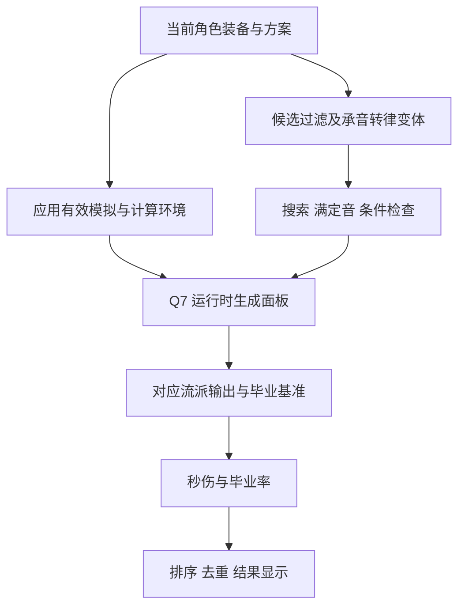
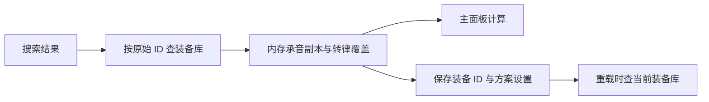
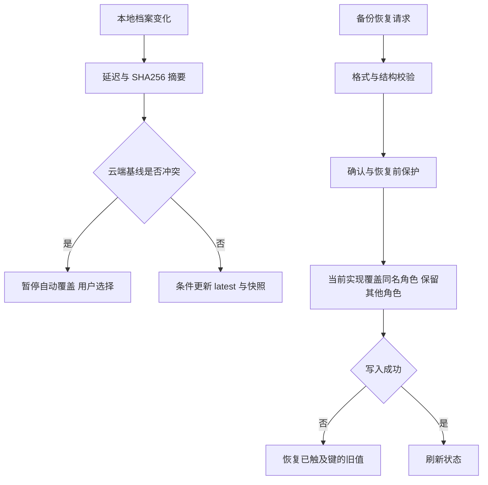

# 软件设计说明：当前实现

> 编写日期：2026-11-08。代码基线：`fa6a1a9b9de81f81415e710f7131d6e827bc598f`。业务依据：本轮用户逐项确认。实现与验证状态见 [SRS](SRS.md) 和 [验证说明](verification.md)。

本文描述基线代码及下文标注的2026-11-11上游兼容增量；未来目标见 [SRS](SRS.md)。用户存储与迁移格式保持不变；引擎导出数据新增上游workbookPatch字段，见下节。未实现的需承音持久化、整体恢复等需求不能直接从本文推导为可用功能。

## 模块与加载

| 源文件 | 当前职责与定位符号 |
| --- | --- |
| [index.html](../static/tools/yysls-tiaolv/index.html) | DOM、脚本顺序、查询版本与页面更新时间 |
| [engine-bootstrap.js](../static/tools/yysls-tiaolv/assets/js/engine-bootstrap.js) | 固定 q7、引擎资源加载 |
| [engine-runtime-adapter.js](../static/tools/yysls-tiaolv/assets/js/engine-runtime-adapter.js) | 应用和 Q7 的运行时适配 |
| [Q7 runtime](../static/tools/yysls-tiaolv/assets/engines/q7/excel-runtime.js) | calculate、calculatePanel、calculateFromPanel、ensureExcel |
| [app.min.js](../static/tools/yysls-tiaolv/assets/js/app.min.js) | AppState、UIManager、GradModal；装备、方案和搜索主流程 |
| [local-customizations.js](../static/tools/yysls-tiaolv/assets/js/local-customizations.js) | 备份校验恢复、转律扩展、数量分配、显示及历史迁移 |
| [best-build-algorithms.js](../static/tools/yysls-tiaolv/assets/js/best-build-algorithms.js) | 算法注册、品质候选去重、遗传核心 |
| [equip-recycle-bin.js](../static/tools/yysls-tiaolv/assets/js/equip-recycle-bin.js) | 角色级回收站、15 天保留 |
| [cloud-backup.js](../static/tools/yysls-tiaolv/assets/js/cloud-backup.js) | 登录、摘要、延迟上传、冲突和快照 |
| [excel-export.js](../static/tools/yysls-tiaolv/assets/js/excel-export.js) | 当前数据回填工作簿并下载 |

页面先加载 bootstrap，再载入 best40 数据、runtime adapter、回收站、本地扩展、算法注册中心和主脚本；之后是 custom-selects、固定 Supabase 2.57.4 SDK、云备份、Excel 导出。OCR 依赖 Tesseract 异步加载。动态引擎资源顺序由 bootstrap 管理，不沿用历史文档的静态双 WASM 顺序。

生产为 Q7 单体 `assets/wasm/q7/yysls_calc.wasm`，引擎资源位于 `assets/engines/q7/`，模板位于 `excels/q7/`。`YYSLS_ACTIVE_ENGINE` 固定 q7；`YYSLSExcelRuntime` 暴露 ready、panelReady、ensureExcel、calculate、calculatePanel、calculateFromPanel、exportClassInputData、clearCache。契约不提供 compiled best-build 方法；历史文档中对应接口不能当作当前公共能力。

## 数据流

`updateStats` 和分析初始化使用 `applySchemeTransmutationSelections` 获取有效装备。该函数返回装备与 invalid 清单，检查位置、目标及当前资格。扩展层 `installTransmutationVariantFilter` 包装主脚本候选函数，加入武器词库修正和用户排除目标；因此只读主脚本不足以判断完整过滤规则。

## 数据契约与存储

| 数据 | 当前表示 |
| --- | --- |
| 装备 | id、slotId、weaponTypeId、name、level、isChengyin、isPurple、isTransmutable、availableClasses、flowType、mainStat、subStats、dingyinStat；词条含 type、value，部分有 isPercent |
| 搜索变体 | 合成 id 含 `_chengyin` 或 `_trans_`；getOriginalEquipId 归并实体，转律元数据含 sourceEquipId、subStatIndex、fromStat、toStat、planned |
| 方案 | 八槽位装备 ID 或空位，加 name、bowType、setType、flowVersion、xinfa、earlySeasonBonus、PVPMode、loanDingyin、loanDingyinValue、classInputOverrides、armory、advancedSettings、transmutationSelections |
| 转律档案 | 角色级映射；active 状态含 subStatIndex、excludedTargets、modelVersion（当前 3），没有槽位记录且具资格表示位置未定 |
| 方案转律覆盖 | sourceEquipId 为键，保存 subStatIndex、targetStat、planned；不持久化原词条身份 |
| 完整备份 | kind=`yysls-tiaolv-full-backup`、schemaVersion=3、accounts、lastSelectedAccount；每个角色含 equipData、recycleBinData、simulatorData、zhuanlvData、manualGradData |

角色列表键为 `game_account_list`；装备与方案分别使用 `game_equip_data_角色名`、`game_sim_data_角色名`；转律使用 `zhuanlv_status_角色名`；回收站使用 `game_equip_recycle_bin_角色名`；手动表单使用 `grad_manual_form_v2_` 前缀。云元数据以 `tiaolv_cloud_` 为前缀。完整备份不会把可重建计算缓存作为档案权威。

`validateFullBackup` 接受 schema 3 和 2，角色名与装备 ID 查重、装备清洗、方案字段白名单及引用处理后返回规范化账户。旧单角色 JSON 走独立兼容入口。`cloneSafeJson` 检查非有限数字、危险对象键和嵌套深度（30）；这些校验不证明云端 RLS 配置正确。

## 搜索流程与参数

原始仓库 → 部位／武器／流派与显式条件过滤 → 阈值承音候选 → 转律候选与实体互斥 → 满定音计算 → 结果复核与去重 → 最多 20 套。`bestBuildCacheKey` 及转律摘要隔离不同条件；任何缓存完整性保证仍需相应回归证据。

算法注册对象包含 id、name、description、search(context)，公开到 `YYSLSBestBuildAlgorithms`。遗传核心 `GENETIC_DEFAULTS` 当前为：4 岛、每岛种群 64、最多 40 代、精英 8、锦标赛 4、交叉率 0.85、变异率范围 0.12～0.35、每 5 代迁移 4 个、停滞阈值 10 代、档案容量 200。这些是源码默认设置，不是实际每次必定运行的代数，也不是强化学习训练或 checkpoint 参数。

默认遍历结果按 rate、sequence 排序，遗传终排按 rate；最终方案身份包含原始装备与承音状态。用户目标的成本次排序、完整等价关系合并需参见 SRS 差异表。取消标志为 bestBuildCancelled，循环与复核阶段会检查，取消结果不保留本次中间解；旧结果保留语义仍有差异。

## 方案应用与重载

`applyBuild` 从原始 ID 查库，当前还有名称与部位回退查找；这条回退与“缺失不自动替换”的目标需要专项检查。`saveSimulatorState` 保存 ID 和覆盖设置，重载以库中记录为准。当前未见需承音安排独立保存，不能保证重载保留承音模拟；搜索满定音是否持续同样需动态验证。记录这些缺口，不在文档任务中设计或发布新 schema。

## 云备份与恢复现状

云端使用 backup_latest 与 backup_snapshots；自动备份延迟 60000 ms，自动快照间隔 30 分钟，历史数量上限 20。通过摘要、条件更新、remote_changed 和账号归属保护避免静默覆盖。云恢复先执行 protectLocalBeforeRestore，再调用共享 restoreFullBackup。服务端表约束、权限策略、真实多设备竞争本次未验证。

当前 restoreFullBackup 合并角色列表并覆盖同名角色，触及键写入失败时回滚；缺失引用可能清理并警告。它不是用户要求的整体替换，也不等于本地成功恢复后有可撤回快照。目标行为见 SRS-DATA-002～004。

## 2026-11-11 Q7快照与Excel导出增量

上游快照为2026年11月10日21:19:51，15个输出版本保持不变，8份模板更新4.0与新基准。Q7 WASM SHA256为 `881f10a3f2d393d06612a2080157a3e3ad2438f351b269594aeaa8450f2659fc`。赛季抗性仍为本地2.45，上游2.15，其他数值按快照同步。

`exportClassInputData`新增`workbookPatch`（来自元数据flowWorkbookPatches）。以前导出器只回填fields/kinds/cells/values，现在同时按sheet分组应用formulas与validations；破竹樽为13项公式和2项下拉补丁，新增第四心法写入期望!E24。只含校验补丁的RD工作表也必须写回。替换公式时删除旧缓存值，保留自动重算标记；模板请求使用no-store，避免同名4.0模板缓存过时。模板源文件保持上游字节一致，补丁仅作用于下载副本。

保留本地`excels/q7/`路径和`ensureExcel`等待，未覆盖上游前端、未修改装备库、方案、搜索和备份行为。导出XML测试证明输入/公式/下拉回填正确；不等价于在Excel或WPS中重算全表并验证其最终数值。

## 2026-11-11 云备份登录反馈修复

`cloud-status`从仅登录后显示的`cloud-logged-in`内部移至登录表单之后的公共区域。登录流程和认证配置不变，未登录时也能看见空输入、进行中、凭据错误、网络失败及SDK缺失提示。自动备份、冲突保护与恢复语义未改。现场发现认证项目域名无法解析；需要在Supabase控制台核对项目状态，不能把前端反馈修复当作服务端已恢复。
